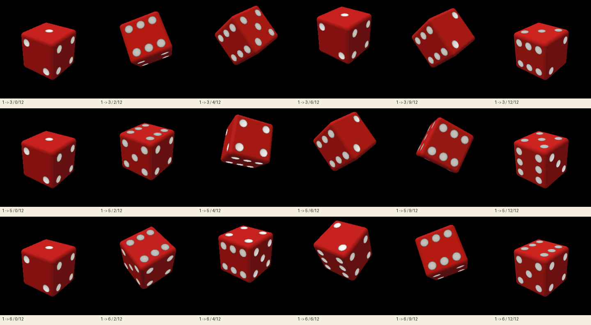

> ## 🗄️ This repository is archived / 本仓库已归档
>
> The dice now lives inside the **Family Hub** system, as one of its apps:
> **https://github.com/esp32gallery/esp32-family-hub**
>
> The device runs **one** firmware with two apps on its home screen — `Roll Dice` and `Voice Notes`.
> Rolling dice here is no longer a separate project; flashing this repo gives you an older
> renderer that is no longer maintained.
>
> 骰子现在是 **Family Hub** 系统里的一个 App，最新实现在：
> **https://github.com/esp32gallery/esp32-family-hub**（`family-hub/family-hub.ino`）
>
> 这里保留作历史记录。**不要从这里刷机** —— 拿到的是旧渲染器。

# Home Dice · 3D Dice

A 3D dice roller for the **Waveshare ESP32-S3-Touch-AMOLED-2.16**. Roll with the touchscreen, shake gesture, or the board's GPIO18 button. The Arduino sketch renders the dice locally on the 480×480 AMOLED.

This repository also includes a browser preview that replays pre-rendered frames. It is an interactive visual replay, **not an ESP32 firmware simulator**.


<sub>Animation made from the project's rendered frames. It does not show firmware running on the physical board.</sub>

| Start | Mid-roll | Result |
| --- | --- | --- |
|  |  |  |

[](preview/)

## Hardware

- Waveshare ESP32-S3-Touch-AMOLED-2.16
- CO5300 480×480 AMOLED
- CST9220 touch controller
- QMI8658 IMU
- GPIO18 board button

## Build the firmware

Open `firmware/dice3d/dice3d.ino` as an Arduino sketch. Install an ESP32 Arduino core and the libraries used by the sketch: Arduino_GFX, SensorLib (QMI8658), and the CST92xx touch driver. Select the Waveshare ESP32-S3 target with 16 MB flash and OPI PSRAM. The exact board package options are in [`firmware/dice3d/BUILD.md`](firmware/dice3d/BUILD.md).

To compile without uploading:

```sh
arduino-cli compile \
  --fqbn "esp32:esp32:esp32s3:PSRAM=opi,PartitionScheme=app3M_fat9M_16MB,CDCOnBoot=cdc,FlashSize=16M,USBMode=hwcdc,UploadSpeed=460800" \
  firmware/dice3d
```

No board upload is performed by the preview or host test.

## Run the browser replay

Serve this repository over HTTP, then open `/preview/`:

```sh
python3 -m http.server 8000
```

Choose a target face, roll, or step through frames. The preview assets are recorded frames; they do not emulate the display bus, touch controller, IMU, or firmware execution.

## Native renderer check

```sh
c++ -O2 -std=c++17 -o /tmp/dice-host firmware/dice3d/host_test.cpp
/tmp/dice-host /tmp
```

This checks the renderer's face orientation and writes sample PPM images to `/tmp`.

## Project structure

- `firmware/dice3d/` — Arduino firmware, SDF renderer, native host check
- `preview/` — browser replay UI and rendered frames

## Source and license

ESP32 Gallery-authored firmware, browser code, rendered preview frames, and
documentation in this repository are released under the
[MIT License](LICENSE). Third-party libraries retain their own licenses; see
the build documentation and upstream package metadata before redistribution.
